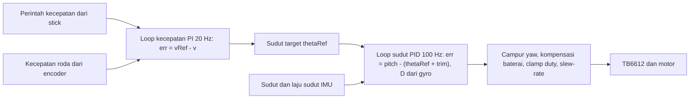
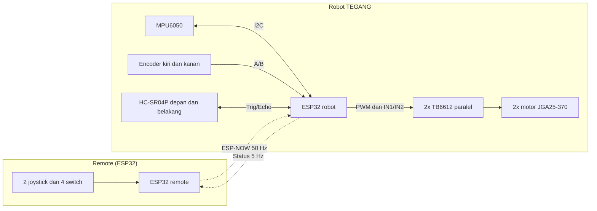
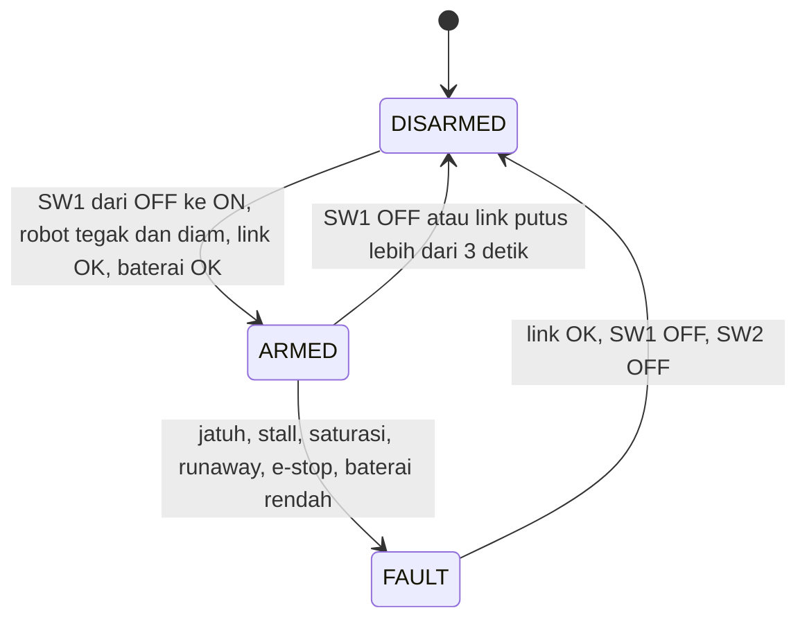
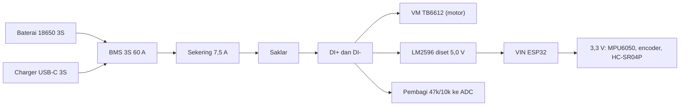

# TEGANG: Self-Balancing Robot

Robot beroda dua yang menyeimbangkan dirinya dengan prinsip **pendulum terbalik** (*inverted pendulum*), dikendalikan oleh **ESP32**, sensor IMU **MPU6050**, dan kontrol **PID bertingkat (cascade)**. Robot dikendalikan lewat **remote rakitan** berbasis ESP32 melalui **ESP-NOW**.

> **Status proyek:** dalam pengembangan. Firmware v1.0 sudah lolos pemeriksaan sintaks tetapi **belum diuji di hardware**. Angka yang ditandai *(perkiraan)* atau *(target)* harus diverifikasi saat perakitan dan pengujian.

## Daftar isi

1. [Gambaran singkat](#1-gambaran-singkat)
2. [Cara kerja](#2-cara-kerja)
3. [Arsitektur sistem](#3-arsitektur-sistem)
4. [Hardware](#4-hardware)
5. [Pinout](#5-pinout)
6. [Kelistrikan dan proteksi daya](#6-kelistrikan-dan-proteksi-daya)
7. [Mekanik dan tata letak](#7-mekanik-dan-tata-letak)
8. [Firmware](#8-firmware)
9. [Protokol komunikasi](#9-protokol-komunikasi)
10. [Instalasi dan pemakaian](#10-instalasi-dan-pemakaian)
11. [Kalibrasi dan uji bertahap](#11-kalibrasi-dan-uji-bertahap)
12. [Panduan tuning PID](#12-panduan-tuning-pid)
13. [Pemecahan masalah](#13-pemecahan-masalah)
14. [Keselamatan](#14-keselamatan)
15. [Struktur repositori](#15-struktur-repositori)
16. [Roadmap](#16-roadmap)

---

## 1. Gambaran singkat

| Item | Keterangan |
|---|---|
| Konsep | Pendulum terbalik: pusat massa berada di atas poros roda, sehingga robot **tidak stabil secara alami** dan harus terus dikoreksi |
| Kontroler | ESP32 DevKit V1 (WROOM-32), loop kontrol 100 Hz |
| Sensor utama | MPU6050 (akselerometer + gyro), encoder pada motor, 2x HC-SR04P ultrasonik |
| Aktuator | 2x motor DC JGA25-370 12 V (280 RPM) berencoder, 2x driver TB6612FNG |
| Daya | 18650 3S (11,1 V nominal) + BMS 3S 60 A, buck LM2596 ke 5 V |
| Kendali | Remote rakitan (2 joystick + 4 switch), ESP-NOW 50 Hz |
| Fitur keamanan | Arm/disarm, e-stop, failsafe link, deteksi stall dan jatuh, cutoff baterai, rem aman ultrasonik |
| Fitur lanjutan (opsional) | Line follower dengan sensor IR 5-channel *(menyusul)* |

## 2. Cara kerja

### 2.1 Prinsip pendulum terbalik

Pusat massa robot berada di atas poros roda. Begitu badan miring, gravitasi makin memiringkannya. Agar tidak jatuh, roda harus bergerak **ke arah miring** supaya berada kembali di bawah pusat massa. Pengendali mengulangi koreksi ini **100 kali per detik**.

```text
badan miring ke depan  ->  roda berputar maju  ->  roda "menyusul" di bawah badan  ->  badan kembali tegak
```

### 2.2 Estimasi sudut (sensor fusion)

- **Akselerometer** memberi sudut absolut dari arah gravitasi, tetapi berisik dan terganggu percepatan.
- **Gyro** memberi laju sudut yang halus, tetapi **drift** bila diintegrasi.
- **Complementary filter** menggabungkan keduanya:

```text
sudut = a * (sudut + gyro * dt) + (1 - a) * sudut_akselerometer        a ~ 0,98
```

Pada MPU6050 diaktifkan juga **DLPF ~42 Hz** untuk meredam getaran motor. Offset gyro dikalibrasi saat boot (robot ditahan tegak dan diam selama 3 detik).

### 2.3 Kontrol bertingkat (cascade)



**Loop dalam (sudut, 100 Hz)** menjaga robot tegak:

```text
err = pitch - (thetaRef + trim)
u   = Kp * err + I + Kd * (laju_sudut_gyro)
```

- Suku **D** memakai laju sudut langsung dari gyro (bukan turunan error), sehingga bebas dari *derivative kick*.
- Suku **I** dibatasi (anti-windup) dan tidak boleh mendominasi keluaran.
- `trim` mengoreksi titik seimbang yang bergeser akibat letak pusat massa.

**Loop luar (kecepatan, 20 Hz)** membuat robot **diam di tempat** (tidak drift) dan mengikuti perintah maju/mundur:

```text
err_v    = vRef - v_roda
thetaRef = Kpv * err_v + Ki_v * integral(err_v)         dibatasi +-6 derajat
```

Untuk **maju**, robot harus **condong ke depan** lebih dulu. Karena itu perintah kecepatan diubah menjadi **sudut target**, bukan langsung menjadi PWM.

### 2.4 Konvensi tanda

| Besaran | Tanda positif berarti |
|---|---|
| Sudut pitch | badan miring ke **depan** |
| Perintah motor `u` | roda berputar **maju** |
| Kecepatan `v` | robot bergerak **maju** |
| Stick LY | **maju** |
| Stick RX | belok **kanan** |

Jika arah di hardware berbeda, ubah konstanta `PITCH_SIGN`, `MOTOR_L_SIGN`, `MOTOR_R_SIGN`, `ENC_L_SIGN`, `ENC_R_SIGN` di `robot_tegang.ino`. **Jangan ubah rumus kontrol.** Motor kanan terpasang berhadapan dengan motor kiri, sehingga tanda motor dan encoder kanan umumnya dibalik.

### 2.5 Pencampuran belok (yaw)

```text
u_kiri  = u + yaw
u_kanan = u - yaw
```

Perintah yaw berupa beda keluaran kedua roda (open-loop), dibatasi oleh `yawmax`.

### 2.6 Normalisasi terhadap tegangan baterai

Baterai 3S turun dari 12,6 V ke sekitar 9,3 V selama pemakaian, sehingga torsi dan kecepatan motor ikut turun. Keluaran dikalikan `11,1 / Vbat` (dibatasi 0,8 sampai 1,4) agar perilaku kontrol tetap konsisten dan hasil tuning tidak berubah-ubah.

### 2.7 Rem aman (obstacle avoidance)

Dua sensor HC-SR04P (depan dan belakang) memantau jarak di task terpisah. Bila ada halangan di bawah **25 cm** (dilepas di atas 32 cm), perintah **maju atau mundur** menuju halangan di-nol-kan. **Loop keseimbangan tetap aktif**, jadi robot berhenti manuver tetapi tetap berdiri di tempat.

## 3. Arsitektur sistem



### Pembagian tugas pada ESP32 robot

| Core | Tugas |
|---|---|
| **Core 1** (`loop`) | Membaca IMU, loop sudut 100 Hz, loop kecepatan 20 Hz, state machine, driver motor, telemetri |
| **Core 0** | Callback ESP-NOW, task ultrasonik (non-blocking terhadap loop kontrol), web server mode tuning |

### State machine



| Kondisi | Aturan |
|---|---|
| **Syarat ARM** | Transisi SW1 OFF ke ON **setelah** link terbentuk, sudut dalam +-3 derajat, laju sudut kecil, link remote OK, baterai cukup |
| **FAULT** | Bersifat **latched**: motor mati dan STBY LOW sampai SW1 dan SW2 OFF |
| **E-STOP** | SW2 ON kapan pun saat ARMED langsung menyebabkan FAULT |
| **Link putus** | >500 ms: perintah di-nol-kan (robot berdiri di tempat); >3 detik: DISARM |

### Daftar proteksi

| Proteksi | Pemicu | Tindakan |
|---|---|---|
| Jatuh | sudut melebihi +-45 derajat | FAULT |
| Stall | `|u|` besar tetapi roda diam selama 250 ms | FAULT |
| Saturasi | keluaran jenuh selama 800 ms | FAULT |
| Runaway | kecepatan roda terlalu tinggi selama 0,5 detik | FAULT |
| Baterai rendah | Vbat di bawah 9,3 V selama 1 detik (pulih di atas 9,6 V) | FAULT; peringatan LED di 10 V |
| Duty clamp | batas duty maksimum (awal 50%) | membatasi arus stall dan lonjakan |
| Slew-rate | maksimal 20% per 10 ms | mencegah pembalikan arah mendadak |
| STBY | hanya HIGH saat ARMED | memutus driver lewat hardware |

## 4. Hardware

### 4.1 Robot

| Komponen | Jumlah | Catatan |
|---|---|---|
| ESP32 DevKit V1 30-pin (WROOM-32) | 1 | Jangan pakai WROVER (GPIO 16/17 dipakai PSRAM) |
| MPU6050 (GY-521) | 1 | Dipasang kaku (baut M2), dekat garis poros roda |
| Modul TB6612FNG | 2 | Satu modul per motor, channel A dan B **diparalel** |
| Motor DC JGA25-370 12 V 280 RPM + encoder | 2 | Poros D 4 mm; encoder 11 pulsa per putaran poros motor |
| Roda 65 mm | 2 | Perlu hub atau adapter untuk poros D 4 mm |
| HC-SR04P (versi 3,3 V) | 2 | Depan dan belakang; Echo aman langsung ke GPIO |
| Buck LM2596 | 1 | Diset **5,0 V** |
| BMS 3S 60 A (balanced) | 1 | Beban ke sisi Discharge (DI-), bukan B- |
| Charger step-up USB-C 3S 12,6 V | 1 | Disambung ke port Charge BMS |
| Baterai 18650 | 3 | Satu merek, satu batch, selisih tegangan di bawah 0,05 V |
| Sekering 7,5 A slow-blow, saklar >=10 A, konektor XT30/XT60 | 1 set | Di jalur positif setelah BMS |

### 4.2 Remote

| Komponen | Catatan |
|---|---|
| ESP32 DevKit (WROOM-32 atau WROOM-32U) | 32U bila butuh antena eksternal |
| 2 modul joystick analog | Dipasok 3,3 V, sumbu di pin ADC1 |
| 4 switch | SW1 = ARM, SW2 = E-STOP, SW3 dan SW4 cadangan |
| Baterai 18650 1S + TP4056 (proteksi) + MT3608 (diset 5,0 V) | Saklar di sisi input boost |

### 4.3 Komponen pasif (robot)

| Komponen | Fungsi |
|---|---|
| Elco 1000 uF 25 V di VM TB6612 | Menampung lonjakan arus dan tegangan balik motor |
| Elco 470 uF 25 V di output LM2596 | Menstabilkan 5 V |
| Elco 100 uF 16 V di VIN ESP32 dan 3,3 V sensor | Mencegah brownout saat radio mengirim |
| Keramik 100 nF di terminal motor, VM/VCC TB6612, ESP32, titik tengah pembagi ADC | Menyaring noise frekuensi tinggi |
| Resistor 47k + 10k | Pembagi tegangan baterai ke ADC (rasio 5,7) |
| Resistor 10k di STBY | Pull-down: motor tidak bergerak saat ESP32 booting |

## 5. Pinout

### 5.1 Robot (ESP32)

| Fungsi | Sinyal | GPIO |
|---|---|---|
| MPU6050 | SDA / SCL | 21 / 22 |
| Motor kiri (TB6612 #1) | PWM (PWMA+PWMB) / IN1 (AIN1+BIN1) / IN2 (AIN2+BIN2) | 13 / 4 / 14 |
| Motor kanan (TB6612 #2) | PWM / IN1 / IN2 | 25 / 26 / 27 |
| STBY (kedua modul digabung) | STBY | 15 (pull-down 10k) |
| Encoder kiri | A / B | 16 / 17 |
| Encoder kanan | A / B | 32 / 33 |
| HC-SR04P depan | Trig / Echo | 5 / 18 |
| HC-SR04P belakang | Trig / Echo | 19 / 23 |
| Baterai (pembagi 47k/10k) | ADC1 | 35 |
| Tombol BOOT (mode tuning) / LED | - | 0 / 2 |

Pin bebas: 34, 36, 39 (input-only). GPIO 34 dicadangkan untuk IR 5-channel (line follower). **Hindari** GPIO 12 (strapping), 1 dan 3 (UART), 6 sampai 11 (flash).

### 5.2 Remote (ESP32)

| Fungsi | GPIO |
|---|---|
| Joystick kiri X / Y | 32 / 34 |
| Joystick kanan X / Y | 35 / 33 |
| SW1 / SW2 / SW3 / SW4 | 25 / 26 / 27 / 14 |
| Monitor baterai remote (opsional) | 36 |
| LED | 2 |

Sumbu analog **wajib pin ADC1** (GPIO 32 sampai 39), karena ADC2 tidak dapat dipakai saat WiFi/ESP-NOW aktif.

### 5.3 Paralel channel TB6612

Tiap motor memakai **kedua channel** satu modul agar batas arus naik menjadi sekitar 2,4 A kontinu dan 6,4 A puncak (stall motor sekitar 2,2 A):

| Disatukan | Ke |
|---|---|
| PWMA + PWMB | satu GPIO |
| AIN1 + BIN1 | satu GPIO |
| AIN2 + BIN2 | satu GPIO |
| AO1 + BO1 | kabel motor 1 |
| AO2 + BO2 | kabel motor 2 |

> Urutan pin di modul untuk channel B adalah **B02 lalu B01** (terbalik). Satukan berdasarkan **nama** (AO1 dengan BO1, AO2 dengan BO2), bukan berdasarkan posisi pin. Salah satu bisa menyebabkan korsleting keluaran.

### 5.4 Motor encoder (6 kabel)

| Warna | Fungsi | Sambung ke |
|---|---|---|
| Merah, Putih | Motor + / - | Keluaran TB6612 |
| Hitam | GND encoder | GND |
| Biru | VCC encoder | **3,3 V** (bukan 5 V) |
| Kuning | Fase A | GPIO ESP32 |
| Hijau | Fase B | GPIO ESP32 |

Encoder memberi 11 pulsa per putaran poros motor per fase. Dengan decoding x4 (PCNT) didapat 44 count per putaran poros motor, atau sekitar **940 count per putaran roda** *(perkiraan; ukur dan isi `ENC_CPR_WHEEL`)*.

## 6. Kelistrikan dan proteksi daya



| Rail | Sumber | Beban |
|---|---|---|
| 9 sampai 12,6 V | BMS setelah sekering dan saklar | VM TB6612, input LM2596, pembagi ADC |
| 5,0 V | LM2596 | VIN ESP32 |
| 3,3 V | Regulator onboard ESP32 | MPU6050, encoder, HC-SR04P |

Aturan penting:

- **Semua beban ke DI- (Discharge)**, bukan langsung ke B-, agar BMS dapat memutus arus.
- Satu titik **GND** bersama.
- **Setel LM2596 ke 5,0 V dengan multimeter sebelum** disambung ke ESP32.
- **Jangan colok USB ke ESP32 saat robot nyala dari baterai.**
- Matikan robot (saklar) saat mengisi baterai.
- Pasang BMS dengan urutan kabel balance yang benar (B- dahulu).

## 7. Mekanik dan tata letak

Rangka **4 tingkat** perfboard double-sided **9 x 15 cm** (15 cm searah poros roda), dipisahkan **standoff M3 60 mm** *(awal 4 per celah; lubang disiapkan untuk 6)*. Motor dipasang **di bawah L1** dengan ujung poros (sisi roda) tepat di tepi PCB.

| Tingkat | Tinggi dari lantai *(perkiraan)* | Isi |
|---|---|---|
| **L4** | ~23 cm | 2x HC-SR04P (berdiri tegak, menghadap depan dan belakang) |
| **L3** | ~17 cm | Holder baterai 3S (komponen terberat) |
| **L2** | ~10,5 cm | BMS, charger, LM2596, sekering, saklar, XT30/XT60 |
| **L1** | ~4,5 cm | ESP32, MPU6050, 2x TB6612, kapasitor, konektor encoder; motor di bawah |

Alasan pembagian:

- **Fungsi yang saling berkomunikasi didekatkan.** ESP32, MPU6050, dan TB6612 satu tingkat, sehingga jalur I2C, PWM, dan encoder pendek.
- **MPU6050 serendah dan sedekat mungkin dengan poros roda** agar noise percepatan ayunan kecil. Posisi kiri-kanan tidak kritis; yang penting sejajar poros di arah depan-belakang.
- **Baterai di atas** menaikkan pusat massa sehingga robot jatuh lebih pelan dan lebih mudah dikendalikan.
- **Sumber noise** (LM2596, motor) dijauhkan dari IMU dan jalur sinyal.

Dimensi: tinggi total sekitar 25 cm *(perkiraan, bergantung pada komponen di L4)*; lebar total sekitar 20 cm.

## 8. Firmware

### 8.1 File

| File | Fungsi |
|---|---|
| `robot_tegang.ino` | Firmware robot (kontrol, proteksi, ESP-NOW, ultrasonik, tuning web) |
| `remote_tegang.ino` | Firmware remote (joystick, switch, ESP-NOW, status robot) |
| `tegang_protocol.h` | Definisi paket dan CRC, **harus identik** di robot dan remote |

### 8.2 Parameter awal (titik mulai, belum diuji)

| Parameter | Nilai awal | Arti |
|---|---|---|
| `kp` | 15,0 | Gain proporsional sudut |
| `ki` | 1,0 | Gain integral sudut |
| `kd` | 0,5 | Gain derivatif (dari gyro) |
| `kpv` | 0,10 | Gain proporsional kecepatan (derajat per cm/s) |
| `kiv` | 0,02 | Gain integral kecepatan |
| `trim` | 0,0 | Offset titik seimbang (derajat) |
| `duty` | 50% | Batas duty maksimum (naikkan bertahap) |
| `vmax` | 25 cm/s | Kecepatan maksimum dari stick |
| `yawmax` | 40 | Beda keluaran maksimum untuk belok |

### 8.3 Mode tuning lewat web

1. **Tahan tombol BOOT 0,6 detik**: robot masuk mode TUNING (perintah gerak dari remote diabaikan, arm dan e-stop tetap berlaku).
2. Sambung ke WiFi **`TEGANG_Tuning`** (kata sandi `12345678`).
3. Buka alamat IP yang tercetak di Serial Monitor.
4. Ubah parameter (nilai di-clamp ke rentang aman), tekan **UPDATE**, dan **SIMPAN KE FLASH** bila sudah cocok.

### 8.4 Perintah Serial (115200 baud)

| Perintah | Fungsi |
|---|---|
| `t` | Telemetri CSV on/off |
| `p` | Tampilkan parameter |
| `s` | Simpan parameter ke flash |
| `c` | Kalibrasi ulang IMU (saat DISARMED) |
| `l` / `r` | Tes roda kiri / kanan 1 detik (roda harus bebas) |
| `h` | Bantuan |

Format telemetri: `T,ms,state,pitch,rate,thetaRef,u,vRef,v,vbat,distF,distB`. Bisa digambar di Serial Plotter atau skrip Python.

### 8.5 Indikator LED

| Pola | Arti |
|---|---|
| Kedip singkat tiap 1 detik | DISARMED |
| Menyala terus | ARMED (kedip bila baterai lemah) |
| Kedip cepat | FAULT |

## 9. Protokol komunikasi

ESP-NOW pada **channel 1** (tetap), tanpa power-save, **unicast** ke MAC robot (ACK dan retry otomatis).

**Remote ke robot, 50 Hz (14 byte):**

| Field | Tipe | Isi |
|---|---|---|
| `ver` | uint8 | versi format paket |
| `buttons` | uint8 | bit 0 sampai 3 = SW1 sampai SW4 |
| `seq` | uint16 | nomor urut (membuang paket lama) |
| `axes[4]` | int16 x4 | -1000 sampai 1000: LX, LY (maju +), RX (kanan +), RY |
| `rbat_dV` | uint8 | tegangan baterai remote x10 (0 = tidak diukur) |
| `crc` | uint8 | CRC8 |

**Robot ke remote, 5 Hz (10 byte):** `ver`, `state`, `fault`, `flags`, `vbat_cV`, `pitch_cdeg`, `crc`.

Remote sengaja **tidak tahu arti** sumbu dan switch; pemetaan ada di firmware penerima. Dengan begitu remote yang sama bisa dipakai untuk perangkat lain.

Pemetaan untuk TEGANG:

| Input | Fungsi |
|---|---|
| Stick kiri Y | Maju / mundur (kecepatan target) |
| Stick kanan X | Belok kanan / kiri |
| SW1 | ARM (OFF lalu ON) / DISARM |
| SW2 | E-STOP |

## 10. Instalasi dan pemakaian

**Kebutuhan:**

- Arduino IDE atau PlatformIO dengan **Arduino-ESP32 core 3.x**
- Library: [`MPU6050_light`](https://github.com/rfetick/MPU6050_light), [`ESP32Encoder`](https://github.com/madhephaestus/ESP32Encoder) (0.11.x atau lebih baru)
- Board: ESP32 Dev Module

**Langkah:**

1. Upload `robot_tegang`. Buka Serial Monitor (115200) dan catat **MAC robot**.
2. Isi `ROBOT_MAC` di `remote_tegang.ino`, lalu upload remote.
3. Nyalakan remote, pastikan SW1 dan SW2 OFF, lalu nyalakan robot.
4. Saat boot, **tahan robot tegak dan diam** sampai kalibrasi IMU selesai.
5. Uji arah dan tanda (lihat bagian berikut) **sebelum** robot berdiri bebas.
6. Untuk ARM: ubah SW1 dari OFF ke ON (robot harus tegak dan diam). E-stop: SW2 ON.

## 11. Kalibrasi dan uji bertahap

Kerjakan berurutan; jangan lanjut sebelum tahap sebelumnya lulus.

1. **Daya:** ukur LM2596 = 5,0 V, MT3608 = 5,0 V, charger = 12,6 V tanpa baterai, tegangan tiga sel seimbang.
2. **Tes meja per modul:** MPU6050 (alamat 0x68, sudut halus), motor dan encoder, ultrasonik (Echo 3,3 V), ADC baterai (kalibrasi `VBAT_CAL`), ESP-NOW dan failsafe.
3. **Arah roda (roda bebas):** ketik `l` lalu `r` di Serial. Roda harus berputar **maju** dan count **positif**. Salah arah putar: balik `MOTOR_x_SIGN`. Count terbalik: balik `ENC_x_SIGN`.
4. **Uji gantung:** miringkan robot ke depan, kedua roda harus berputar **maju**. Bila terbalik, ubah `PITCH_SIGN`. Bila sudut berubah saat robot digerakkan maju-mundur (bukan dimiringkan), pindahkan ke sumbu X (`IMU_ANGLE` dan `IMU_RATE`).
5. **Ukur `ENC_CPR_WHEEL`:** putar roda satu putaran dan baca count.
6. **Berdiri bebas dengan tali pengaman**, duty 50%, permukaan anti-slip.

Rencana kerja lengkap dan lembar centang ada di `docs/Checklist_TEGANG.xlsx`, daftar komponen di `docs/BOM_TEGANG.xlsx`.

## 12. Panduan tuning PID

1. Mulai dari `ki = 0`, `kd` kecil, `kpv = 0`.
2. Naikkan **Kp** perlahan sampai robot berusaha berdiri dan mulai berosilasi, lalu turunkan sekitar 30 sampai 40 persen.
3. Tambah **Kd** sampai osilasi teredam.
4. Tambah **Ki** kecil untuk menghilangkan bias sudut; sesuaikan `trim` bila robot selalu condong ke satu arah.
5. Naikkan **duty** bertahap (50, 70, 85 persen) sambil menguji dorongan ringan.
6. Aktifkan loop kecepatan: naikkan **kpv** perlahan sampai robot diam di tempat tanpa drift. Terlalu besar menyebabkan osilasi lambat (robot maju-mundur).
7. Catat setiap percobaan (Kp, Ki, Kd, duty, lama berdiri) pada `Log_Tuning` di `Checklist_TEGANG.xlsx`.

## 13. Pemecahan masalah

| Gejala | Kemungkinan sebab | Tindakan |
|---|---|---|
| Robot langsung jatuh ke satu arah | Tanda sudut atau motor terbalik | Uji gantung; ubah `PITCH_SIGN` atau `MOTOR_x_SIGN` |
| Satu roda berputar mundur | Motor kanan terpasang berhadapan | Balik `MOTOR_R_SIGN` |
| Robot berosilasi cepat | Kp terlalu besar atau Kd kurang | Turunkan Kp, naikkan Kd |
| Robot berosilasi pelan maju-mundur | `kpv` terlalu besar | Turunkan `kpv` |
| Robot terus drift | `trim` salah atau Ki kecil | Atur `trim`, cek loop kecepatan |
| "IMU tidak terdeteksi" | Kabel I2C, VCC, atau alamat | Cek SDA 21, SCL 22, 3,3 V, GND |
| ARM ditolak | Robot belum tegak/diam, link putus, baterai rendah | Baca pesan di Serial |
| FAULT stall | Roda tertahan atau `u` terlalu tinggi | Bebaskan roda; cek arah dan encoder |
| ESP32 reset acak | Brownout saat radio mengirim | Cek elco 100 uF di VIN dan 5 V |
| ESP-NOW tidak nyambung | MAC salah, channel berbeda | Cek `ROBOT_MAC`, `ESPNOW_CHANNEL` sama di kedua sisi |
| Driver panas | Duty tinggi, stall lama | Turunkan duty; cek proteksi stall |
| Pembacaan baterai meleset | Faktor kalibrasi | Sesuaikan `VBAT_CAL` dengan multimeter |

## 14. Keselamatan

- Baterai Li-ion berenergi besar: gunakan sel asli, BMS, dan sekering; jangan korsletkan.
- **Lepas roda dari tanah** (atau gantung robot) saat uji pertama dan saat mencoba motor.
- Selalu pakai **tali pengaman** saat tuning awal, dan sediakan saklar fisik yang mudah dijangkau.
- Jauhkan tangan dari roda saat robot ARMED.
- Isi baterai saat robot **mati**, dan jangan tinggalkan pengisian tanpa pengawasan.
- Jangan menyambung USB ke ESP32 saat robot memakai daya baterai.

## 15. Struktur repositori

Usulan susunan:

```text
.
├── README.md
├── firmware/
│   ├── robot_tegang/
│   │   ├── robot_tegang.ino
│   │   └── tegang_protocol.h
│   └── remote_tegang/
│       ├── remote_tegang.ino
│       └── tegang_protocol.h        (salinan identik)
├── docs/
│   ├── BOM_TEGANG.xlsx
│   ├── Checklist_TEGANG.xlsx
│   ├── schematic/                   (skematik EasyEDA, PDF)
│   └── layout/                      (tata letak 4 tingkat)
└── images/                          (foto dan diagram)
```

## 16. Roadmap

- [x] Desain sasis, tata letak, dan pinout
- [x] Firmware v1.0 (kontrol, proteksi, ESP-NOW, tuning web)
- [ ] Uji hardware dan verifikasi tanda arah
- [ ] Tuning PID sampai berdiri stabil
- [ ] Kendali remote halus dan uji jangkauan
- [ ] Verifikasi `ENC_CPR_WHEEL`, `VBAT_CAL`, dan angka perkiraan di dokumen ini
- [ ] *(Opsional)* Line follower dengan IR 5-channel (GPIO 34)
- [ ] *(Opsional)* Antena eksternal (WROOM-32U) bila jangkauan kurang

## Lisensi dan kredit

Lisensi: belum ditentukan. Dibuat oleh: *(isi nama/tim)*.
